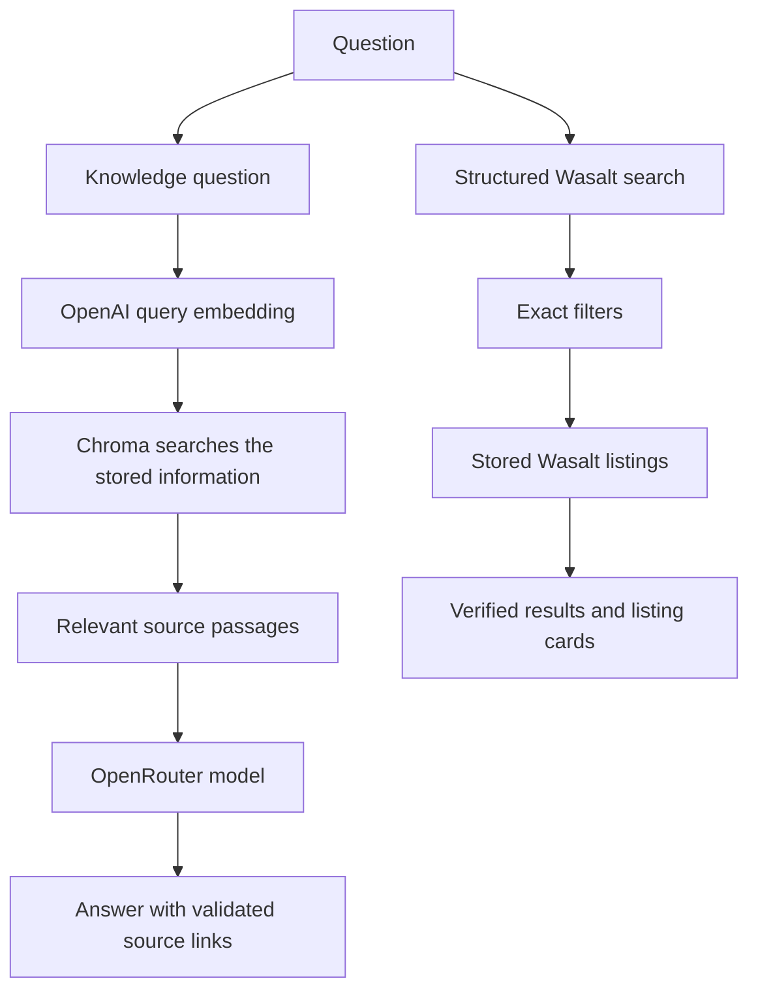

# RealtyAI

RealtyAI helps you explore DarGlobal developments and search historical Wasalt
property listings through natural-language questions. It finds relevant stored
information, gives answers with original source links, and supports follow-up
questions.

**Live Demo:** [Open RealtyAI](https://realtyai-rag-chatbot.onrender.com)

**Source Code:** [GitHub repository](https://github.com/PrasannaKumar29/realtyai-rag-chatbot)

**[Watch Demo Video](https://drive.google.com/file/d/1XoDjnNbFg1ysRWl2EHFr7sYvwCvczrwP/view?usp=sharing)**

## Try These Questions

- What is the AIDA development in Oman?
- What developments does DarGlobal have in Spain?
- Show villas for rent in Riyadh under SAR 100,000 per year.
- How is DarGlobal different from Wasalt?

You can ask supported follow-ups, such as “What amenities does it have?” after a
project question, or “Only those under SAR 100,000 per year” after a rental search.
If the subject is unclear, RealtyAI may ask you to clarify.

## What RealtyAI Can Do

- **Explain DarGlobal developments** using information from the collected pages.
- **Search historical Wasalt listings** by listing ID or exact conditions such as
  city, property type, sale or rent, price, area and bedrooms.
- **Continue supported conversations** about the same project or narrow a previous
  property search. Explicit new topics take priority over earlier context.
- **Show original source links** with factual answers and property cards.
- **Accept English and Arabic questions.** Supported wording and available source
  information determine what it can answer.

Missing property details stay unknown. A listing absent from the collected data
may still exist on the live website. The collection is not a complete catalogue
of either company's properties or services.

## How It Works

Instead of relying only on what an AI model remembers, RealtyAI searches a
prepared collection of website information and uses the relevant passages to
answer the question. This approach is called retrieval-augmented generation, or
**RAG**.

There are two paths:



An *embedding* is a numerical representation that helps find passages with a
similar meaning to the question. Chroma stores and searches these representations.
The application checks citation IDs and connects them to the original source URLs.

Pure structured searches use exact filters and stored records. They make **no
OpenAI embedding or OpenRouter generation calls**. Questions asking for an
explanation can use the AI answer path.

## Data Sources

The collection contains **685 source documents**, captured on **18 November 2026**:

| Source | Documents |
|---|---:|
| [DarGlobal](https://darglobal.co.uk/) public pages | 419 |
| [Wasalt](https://wasalt.sa/) property pages | 261 |
| Wasalt informational pages | 5 |

The prepared collection contains **1,709 indexed passages** and **261 structured
Wasalt listing records**. The [runtime bundle](runtime_assets/) includes the
prebuilt index, text, listing data and a [checksum manifest](runtime_assets/manifest.json).

These are historical snapshots, not a live property feed. Prices and availability
must be checked on the original website. Public sources are attributed through
their original links; their inclusion does not imply endorsement.

## Important Demo Limitations

**Free language-model rate limits.** RealtyAI uses a free model through
OpenRouter. If you see “Rate limit reached; please try again later”, allow some
time and retry. Rate limits can temporarily prevent AI-generated answers even
when the website is working. Recovery time and model availability are not
guaranteed. Pure structured property searches do not depend on this model.

**Render Free hosting.** The service may sleep when idle, so the first visit
after inactivity can take longer. See [Render's free-service limits](https://render.com/docs/free).

**Historical Wasalt data.** Collected listings are not current live listings.
Verify pricing, availability and other details with the original source.

## Run Locally

You need Git and Docker with Buildx support. The prebuilt knowledge index is
included, so you do not need to scrape websites or create embeddings again.

1. Clone the repository:

   ```sh
   git clone https://github.com/PrasannaKumar29/realtyai-rag-chatbot.git
   cd realtyai-rag-chatbot
   ```

2. Create a local environment file:

   ```sh
   cp .env.example .env
   ```

   Open `.env` locally and fill in `OPENAI_API_KEY` and `OPENROUTER_API_KEY`.
   Keep the other defaults. Docker passes these settings as environment variables
   at runtime; credentials are not built into the image. `.env` is Git-ignored:
   never commit it or share its contents. OpenAI query embeddings may incur charges.

3. Build the Linux AMD64 image:

   ```sh
   docker buildx build --platform linux/amd64 --load -t realtyai:local .
   ```

4. Start RealtyAI:

   ```sh
   docker run --rm --platform linux/amd64 --name realtyai-local \
     -p 10000:10000 --env-file .env realtyai:local
   ```

5. Open **http://localhost:10000**. Stop the app with Ctrl-C.

For pure structured property searches, you can leave both API keys blank. The
Docker image sets the data paths and uses port `10000`. The health endpoint is
`/_stcore/health`.

The defaults use `text-embedding-3-small` with 1,536 dimensions and
`baidu/ernie-5.5-flash-preview:free` with reasoning enabled. Keep the embedding
settings unchanged so they match the included index. The optional free-model
fallback is disabled by default. Other supported settings are listed in
[`.env.example`](.env.example).

## Technologies Used

| Technology | Role |
|---|---|
| Python | Runs the application and exact property filters |
| Streamlit | Provides the chat interface and listing cards |
| ChromaDB | Searches the prepared knowledge collection |
| OpenAI embeddings | Converts knowledge questions into searchable representations |
| OpenRouter / ERNIE 5.5 Flash Preview | Generates answers from selected source passages |
| Docker | Packages the app and prebuilt data together |
| Render | Hosts the public demo |

The project has **224 passing automated tests** covering routing, follow-ups,
filtering, source validation and UI behavior. The full development suite requires
original local corpus fixtures that are not included in the runtime distribution.

## Disclaimer

RealtyAI is an independent technical-assignment demonstration built using publicly
available information. It is not an official product of DarGlobal or Wasalt and
is not sponsored or endorsed by either company.
