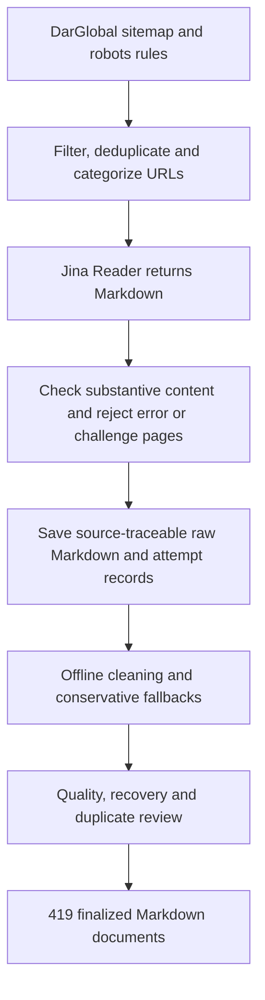
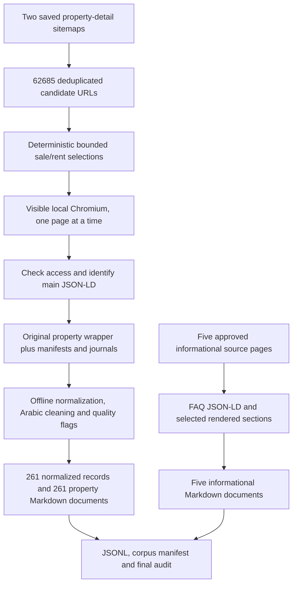

# DarGlobal and Wasalt — Data Extraction Interview Guide

This guide explains the completed work using the local code, source captures, manifests, and final reports. It describes the repository **after Checkpoint 17B**, not the old root-level layout. No website was requested to prepare this guide.

**Interview headline:** We prepared 419 DarGlobal documents and 261 Wasalt property records, plus five Wasalt informational documents. DarGlobal used a webpage-to-Markdown workflow; Wasalt used local visible Chromium to capture embedded JSON-LD, followed by offline normalization and Markdown export.

The collection is a historical snapshot from **18 November 2026**. It is not a live marketplace feed.

## Contents

1. [Verified results and evidence boundaries](#1-verified-results-and-evidence-boundaries)
2. [DarGlobal extraction walkthrough](#2-darglobal-extraction-walkthrough)
3. [Wasalt extraction walkthrough](#3-wasalt-extraction-walkthrough)
4. [Final data structure and application handoff](#4-final-data-structure-and-application-handoff)
5. [How the next stage should consume these files](#5-how-the-next-stage-should-consume-these-files)
6. [Interview answers](#6-interview-answers)
7. [Quick-reference cheat sheet](#7-quick-reference-cheat-sheet)
8. [Local evidence and historical uncertainties](#8-local-evidence-and-historical-uncertainties)

## 1. Verified results and evidence boundaries

| Item | Verified local result |
|---|---:|
| DarGlobal finalized Markdown documents | 419 |
| Wasalt discovered unique URLs | 62,685 |
| Wasalt retained properties | 261 |
| Wasalt sale / long-term rent | 131 / 130 |
| Wasalt raw JSON / normalized JSON / property Markdown | 261 / 261 / 261 |
| Wasalt informational documents | 5 |
| Wasalt FAQs within the FAQ document | 6 |
| Wasalt corpus-manifest entries | 266 |
| Wasalt tests recorded after migration | 48 passing |

**Do not mix these numbers:** a sitemap URL is a discovery candidate; an extraction attempt can fail; a finalized document is an accepted output. Wasalt's 62,685 URLs are not 62,685 verified active properties.

There are two kinds of evidence:

- **Directly inspectable:** final files, JSON values, timestamps, CSV/journal results, code, checksums, and report counts.
- **Historical experiment notes:** earlier Colab/browser observations, recorded in the handoffs. These explain the decisions but are not fresh experiments conducted for this guide.

For DarGlobal, the supplied reference is the methodology source of truth, but it explicitly says its cleaner is illustrative. It is **not a complete, exact rerun of the final Colab cleanup and recovery workflow**. The supplied final corpus and reports remain authoritative.

## 2. DarGlobal extraction walkthrough

### 2.1 What the website contains

DarGlobal's site describes its international real-estate developments, company information, communities, branded partners, press announcements, insights, and blog articles. The result is mainly factual and descriptive website text, rather than a uniform table of marketplace listings.

The final categories are:

| Final category directory | Documents |
|---|---:|
| `blog/` | 241 |
| `press/` | 68 |
| `developments/` | 36 |
| `insights/` | 26 |
| `project_listings/` | 15 |
| `communities/` | 13 |
| `partners/` | 11 |
| `corporate/` | 9 |
| **Total** | **419** |

`project_listings` contains project/category overview pages; `developments` contains individual development pages. Those are different content roles.

### 2.2 Discover, filter, and categorize URLs

The historical handoff records that `robots.txt` advertised `https://darglobal.co.uk/sitemap.xml`. Its Colab exploration found 480 sitemap entries and selected 458 unique URLs after filtering. These are earlier discovery figures, not the final document count.

The supplied Python reference shows the intended logic:

1. Read sitemap `<loc>` elements and remove repeated URLs.
2. Keep the DarGlobal host.
3. Exclude query-bearing URLs and low-value paths such as contact, registration, login, and selected terms pages. The reference also excludes the homepage during selection.
4. Check robots rules through `RobotFileParser`.
5. Categorize paths into blogs, press, insights, partners, project listings, communities, corporate pages, and developments.

Individual development URLs often sit directly under the site root. Looking only for `/projects/` would miss them. The categorizer uses known path rules and a development fallback; this remains an approximate classification, not a semantic guarantee.

### 2.3 Why the initial methods were unreliable

| Method | Recorded observation | Decision |
|---|---|---|
| Direct `requests` | Historical notes describe HTTP 200 with a short Imperva/Incapsula verification response, including `_Incapsula_Resource`. The archived direct-HTML pilot also records a challenge. | Reject challenge content even when the status is 200. |
| Colab Playwright | Historical notes say it sometimes returned useful text and sometimes only verification content. | Browser automation was not a dependable DarGlobal route in that environment. |
| Jina AI Reader | Returned readable Markdown in the early sample; the supplied reference and final data document the Reader workflow. | Use the working webpage-to-Markdown route, with content validation. |

**Imperva was an access/content problem, not a Python parsing problem.** A request can succeed technically while delivering the wrong page. The archived pilot logs corroborate challenge detection; the exact early browser measurements come from the handoff notes.

Jina was selected because it returned usable text for this site. That success did not imply it would work for Wasalt, nor did it remove the need to stop on restrictions.

### 2.4 How Jina output became raw Markdown

The reference requests `https://r.jina.ai/` followed by the original DarGlobal URL, asking for text output. It reads the returned title and the section following `Markdown Content:`.

The initial formatting removes inline image markup while keeping useful image-label text, and normalizes excessive blank lines. Therefore, “raw Markdown” here means the **source-traceable Reader text saved before final cleaning**, not original webpage HTML.

Each saved page has YAML frontmatter:

- `title`
- `source_url`
- `source_type`
- `scraped_at`

The filename uses a readable URL slug plus an eight-character hash derived from the URL. This avoids collisions while keeping files recognizable. The reference saves one page per Markdown file and records attempts in a CSV manifest.

### 2.5 Validation, cleaning, failures, and duplicates

The reference checks for access/error markers, application failures, 404 headings, and insufficient text. Its minimum-content check is 800 characters. That is a documented reference rule; it should not be presented as proof that every final cleaning decision used exactly that threshold.

The final cleaning report shows:

- 409 documents cleaned in standard mode.
- 10 conservative fallbacks.
- 14 documents with warnings.

Cleaning targeted repeated navigation/form material, image placeholders, unnecessary whitespace, and other boilerplate while preserving useful headings, facts, lists, and source metadata. Conservative fallback matters because removing everything after a registration heading can accidentally discard valid content that follows it.

The reference records failures, skips existing outputs, uses a two-second batch delay, and stops on access-related errors or three consecutive failures. The supplied historical recovery report separately records 15 recovery entries: ten recovered and five still invalid. These are **historical reviewed recovery attempts**, not Wasalt's no-automatic-retry policy.

Deduplication has two levels:

- Exact-text comparison: normalize body whitespace/case and compare hashes.
- Near-duplicate review: the supplied CSV contains 40 candidate pairs and similarity scores. Similar marketing articles were candidates for review; the CSV does not mean all 40 pairs were deleted.

Invalid and duplicate captures are retained in `quarantine/`. The final local inspection reports zero exact duplicate groups across the 419 final documents.

**Do not derive the final count by adding unrelated logs.** The raw attempt manifest has 461 rows: 418 successes and 43 failures. The quality audit has 422 rows, and later cleaning has 419. These are different workflow snapshots, not one complete event ledger whose counts can be added directly.

### 2.6 Actual process diagram



The diagram describes the documented workflow. The short preserved reference does not implement every final recovery or near-duplicate-review step.

### 2.7 Real DarGlobal example

File: [`data/darglobal/final/markdown/developments/trump-international-hotel-and-tower-dubai-5e673d5f.md`](../data/darglobal/final/markdown/developments/trump-international-hotel-and-tower-dubai-5e673d5f.md).

| Field | Actual value |
|---|---|
| Title | Trump International Hotel & Tower Dubai \| DarGlobal |
| Source URL | `https://darglobal.co.uk/trump-international-hotel-and-tower-dubai` |
| Source type | `developments` |
| Collection timestamp | `2026-11-18T11:28:35.651255+00:00` |

The document describes a Dubai development on Sheikh Zayed Road, with hotel, residential, and club components. It contains unit information, amenities, development status, and source statements about handover. Treat those statements as the recorded source snapshot, not current verification.

The cleaning report records a reduction from 4,545 to 3,792 characters for this file. It still contains map attribution and FAQ answers without corresponding questions. This is a useful interview example of honest quality reporting: **finalized does not mean every source-formatting defect disappeared**. Do not invent the missing FAQ questions or silently reconcile differing area presentations.

## 3. Wasalt extraction walkthrough

### 3.1 What the website contains

Wasalt is a Saudi real-estate platform. Its public content includes sale and rental listings, projects, service descriptions, platform FAQs, and auctions. Unlike DarGlobal's editorial/development pages, the selected property pages expose relatively consistent structured listing records.

The final property sample has nine title-derived types: 47 apartments, 46 villas, 46 land listings, 46 floors, 46 buildings, 20 rest houses, eight rooms, one chalet, and one duplex. There are 23 source city labels. Their original spellings are retained.

### 3.2 Sitemap discovery: 62,685 candidates

The two known property-detail endpoints are:

- `https://cdn.wasalt.sa/sitemap/product_sitemap_en_sa.xml.gz`
- `https://cdn.wasalt.sa/sitemap/rental_pdp_sitemap_en_sa.xml.gz`

`wasalt_discover.py` downloads and preserves the original response bytes, detects gzip through its magic bytes, rejects XML DTD declarations, checks the `urlset` structure, and extracts `<loc>` URLs without silently truncating the inventory. It canonicalizes URLs, deduplicates them, and keeps sitemap provenance and discovery timestamps.

Despite the `.gz` names, **the locally saved responses contained uncompressed XML**; the report records zero gzip layers for both. Earlier handoff notes describe compressed downloads from Colab. The saved response/report is the evidence for this local run.

| Current local discovery | Count |
|---|---:|
| Product sitemap entries / unique URLs | 60,000 / 60,000 |
| Daily-rental sitemap entries / unique URLs | 2,695 / 2,685 |
| Total entries / unique URLs | 62,695 / 62,685 |
| Sale candidates | 45,389 |
| Long-term rental candidates | 14,611 |
| Daily-rental candidates | 2,685 |

The daily-rental URL ending in `/null` occurs 11 times. Deduplication removes ten repeat entries but retains one flagged URL with no numeric ID. There are no reported ID collisions within each purpose. Daily-rental IDs are kept separate from long-term property IDs.

An earlier observation was 62,666 unique URLs. The local discovery increased by 19; the sale/rent split also changed. We reported the observed differences instead of forcing an earlier count.

`discovered_urls.csv` preserves `source`, string `listing_id`, `source_url`, `purpose`, `sitemap_source`, and `discovered_at`. A URL's purpose comes from `/property/sale/`, `/property/rent/`, or `/dailyrental/`. These slugs did not provide usable city/district classifications.

### 3.3 Why collection was bounded

The goal was a balanced, useful corpus, not a complete marketplace copy. We first checked access, then normalized two seed properties, then tested ten diverse listings, then added 50, then selected a 200-property expansion.

Selection was deterministic and excluded previous IDs. The 200 expansion selections used seed `20261118200`, included 100 sale and 100 rent URLs, and favored varied property types and listing-ID ranges. They were divided into four disjoint batches of 25 sale plus 25 rent each. This is deliberate coverage sampling, not a statistically representative market sample.

The unique-property arithmetic is:

**2 seed properties + 10 sample properties + 50 sample properties + 199 successful expansion properties = 261.**

Revisiting a seed property during feasibility testing did not create a new unique listing. Daily-rental URLs were discovered but daily-rental listings were not included in the property corpus.

### 3.4 Failed experiments versus the successful route

| Method | Historical result |
|---|---|
| Direct Colab `requests` to property pages | HTTP 403, Cloudflare verification content. |
| Jina Reader for Wasalt | HTTP 200 but challenge content rather than a usable listing. |
| Colab Playwright | After resolving missing Linux browser libraries, Chromium launched but navigation still returned HTTP 403 and no JSON-LD. |
| Ordinary desktop Chrome | Pages loaded, and manual exports established the available JSON-LD schema. |
| Local visible Playwright Chromium | Successful property acquisition, corroborated by saved records and batch manifests. |

The browser-library issue and access restriction were separate problems. Installing browser libraries fixed launching Chromium; it did not fix Cloudflare access from Colab.

We did not use stealth plugins, proxies, CAPTCHA solving, or copied session tokens. Local success demonstrated access from that environment at collection time; it does not establish that Cloudflare can always be avoided or that the same method will always work.

### 3.5 Finding the main property JSON-LD

JSON-LD is structured JSON embedded in webpage script elements. Here, the extractor reads `script[type="application/ld+json"]` after loading the page. Useful fields include `name`, `address`, `offers`, and bedroom/bathroom counts.

A page can contain breadcrumbs, offers, and other records. The code parses all JSON-LD scripts, traverses nested records, and does **not** assume the first object is the requested property.

Main-record selection prefers a matching URL or listing identifier. Where the source omits these identifiers, it matches the property name against the actual page title. It rejects missing or ambiguous candidates. This title fallback is a practical matching heuristic, not independent ownership or availability verification.

The wrapper records the requested URL, string listing ID, purpose, timestamp, and complete selected property JSON-LD. The original selected object's values are retained. Raw property files are not full HTML archives or copies of every JSON-LD object on the page.

### 3.6 Batches, logs, atomic writes, and stop rules

The extractor opens visible Chromium with concurrency one and a three-second delay between listings. Each batch uses a prepared manifest; the code bounds accepted batch sizes and validates unique IDs, URLs, and sale/rent balance. It prevents extra document navigations for other pages, reloads, or redirects.

The CSV records HTTP status, extraction status, JSON-LD record count, main-property detection, output path, error reason, timestamp, and page title. Later batches also record a failure category. Script counts and JSON-LD record counts are different measurements: an array or graph can contain multiple records in one script.

For expansion batches, durable journals contain:

- `batch.json`: the selected identities.
- `{listing_id}.started.json`: durable evidence that an attempt began.
- `{listing_id}.result.json`: the result saved before the CSV row is flushed.

Raw JSON is written to a temporary file, flushed, and atomically published without replacing an existing destination. This avoids half-written final raw records. A journal can preserve attempt history even if a CSV is interrupted.

Resumption is explicit and uses a new output manifest. It continues untouched listings without automatically retrying prior successful, failed, or interrupted attempts. It refuses resumption after a recorded access block. It is not an automatic retry system.

| Situation | Final implemented behavior |
|---|---|
| HTTP 404/410 | Record an unavailable failure; continue without retry. |
| HTTP 401/403/429 or a security challenge | Stop further requests immediately. |
| HTTP 5xx/network/extraction failure | Record without retry; stop after two consecutive such failures, or a fatal browser/storage problem. |
| Missing or malformed main JSON-LD | Record as invalid; do not fabricate a property. |
| Existing raw record | Preserve it; do not request it again. |

Earlier checkpoints stopped for review after an ordinary failure. After review, the final policy allowed unavailable URLs to be recorded while continuing. Preserve this distinction when explaining the sequence.

All four expansion batches reconcile to **200 attempts, 199 successes, one HTTP 404, and zero blocked, invalid, skipped, or pending results**. The failed rental listing is `5842008`; it remains in logs and is excluded from all prepared property outputs.

### 3.7 Offline normalization and quality checks

`normalize_property(raw_record)` produces a new dictionary without changing the raw wrapper:

- Retain source URL, string ID, purpose, and collection timestamp.
- Use an explicit property-type field when supported; otherwise classify the title. All 261 actual records carry the title-inference warning.
- Preserve `schema_org_type`. The source labels all 261 records `SingleFamilyResidence`, including land and buildings; that label is not treated as the actual property type.
- Parse SAR prices numerically and separate the payment period. Both `SAR /Year` and the observed Arabic `SAR /سنة` map to `price_period = year`.
- Prefer an explicit, supported area field; otherwise use a clearly formatted title area and record `area_source = title`. Never decode area from URL-slug numbers.
- Preserve missing optional values as null, not zero. Avoid inapplicable bedroom/bathroom warnings for land, buildings, and room listings.
- Keep the original description, clean a separate copy, and retain Arabic text and paragraph breaks.
- Remove phone numbers, emails, common contact links, and recognized contact-person lines from the cleaned description.

Two real redaction lessons became regression tests: two adjacent phone numbers needed separate recognition, and a mobile-phone icon describing a smart home must not cause the property paragraph to be removed. Long prices must also remain prices rather than being mistaken for phone numbers.

The checks are deliberately limited. They detect explicit room/area disagreements, not comprehensive Arabic semantics. An alternative rental price tied to a different number of payments is retained and flagged as payment information rather than automatically called a contradiction.

| Final quality result | Count |
|---|---:|
| Valid properties with warnings | 261 |
| Invalid finalized properties | 0 |
| Missing descriptions | 9 |
| Missing areas | 13 |
| Missing bedrooms | 101 |
| Missing bathrooms | 253 |
| Area-description discrepancy flags | 3 |
| Room-description discrepancy flags | 3 |

These warning counts do not make every omission an error. A missing bathroom field in a land listing is different from an invalid source URL. Source spelling and unresolved discrepancies remain visible.

### 3.8 Real example: raw JSON → normalized JSON → Markdown

Use listing **`5891036`**, a long-term rental villa:

- Raw: [`data/wasalt/raw/rent/5891036.json`](../data/wasalt/raw/rent/5891036.json).
- Normalized: [`data/wasalt/normalized/rent/5891036.json`](../data/wasalt/normalized/rent/5891036.json).
- Markdown: [`data/wasalt/properties/rent/5891036.md`](../data/wasalt/properties/rent/5891036.md).

| Attribute | Raw source | Normalized output | Markdown presentation |
|---|---|---|---|
| Identifier | Wrapper `listing_id: "5891036"` | Same string | YAML listing ID |
| Type | `SingleFamilyResidence`; title says villa | `property_type: villa`; original schema type retained | Villa |
| Price | `offers[0].price = 120000` | `price_sar: 120000` | SAR 120,000/year |
| Currency/frequency | `SAR /Year` | `SAR` and `year` in separate fields | Yearly period remains explicit |
| Area | Title contains `250 SQM`; no dedicated area field | `area_sqm: 250`, `area_source: title` | 250 sqm, identified as title-derived |
| Bedrooms/bathrooms | Strings `"9"` and `"6"` | Numbers 9 and 6 | Both shown |
| Location | Riyadh, North Riyadh, An-Narjis | City, region, district retained separately | Readable location |
| Description | Original Arabic HTML, including contact information | Original retained; separate cleaned Arabic text | Cleaned Arabic paragraphs |
| Collection time | `2026-11-18T15:30:17.297102Z` | Same value as `scraped_at` | Same timestamp in YAML |

The description includes SAR 120,000 for one payment and SAR 125,000 for two payments. The prepared record keeps the structured SAR 120,000/year offer and preserves the payment detail, with `payment_options_in_description` flagged. It does not invent a second structured offer.

Another useful example is sale listing `5891090`: the title gives 122.58 sqm and four bedrooms, but no structured bathroom count exists. The normalized bathroom stays null even though the description mentions bathrooms. Its explicit three-room description versus four structured rooms is flagged.

We keep both JSON and Markdown because they serve different roles: JSON gives consistent fields and joins; Markdown gives readable source context. They are two representations of the same property, not two independently discovered properties.

### 3.9 The five informational documents

| Document under `data/wasalt/informational/` | Actual source content |
|---|---|
| `faq.md` | All six homepage FAQ pairs from `FAQPage` JSON-LD; original wording preserved. |
| `corporate.md` | Selected company overview and platform-purpose sections. |
| `services.md` | Public search, projects/masterplans, auctions, business/app services, and brief daily-rental information. |
| `projects/shams_al_riyadh.md` | One named project's structured record and rendered overview; original Arabic retained. |
| `auctions.md` | Public real-estate auction explanation and selected relevant terms; no auction listings or non-property assets. |

Only five approved source URLs were used: the homepage, corporate page, named project, auction terms, and auction landing page. Their URLs and individual collection timestamps remain in document frontmatter and source evidence. Multiple sources can contribute to one document; keep the entire `source_urls` and `source_extracted_at` metadata, not just the primary URL.

The landing page supplied no substantive explanation or FAQ to export. Daily-rental guidance was only a short service statement, not booking/cancellation policy. No developer was found in the captured project overview; east-versus-north Riyadh location statements were preserved as a discrepancy. No additional project pages or authenticated workflows were explored for this collection.

### 3.10 Actual process diagram



## 4. Final data structure and application handoff

**This is the main handoff section. Use finalized outputs as inputs and preserve extraction evidence.**

```text
darglobal-rag/
├── data/
│   ├── darglobal/
│   │   ├── final/
│   │   │   ├── markdown/{blog,press,developments,insights,...}/
│   │   │   ├── cleaning_report.csv
│   │   │   ├── summary.json
│   │   │   └── validation_report.json
│   │   ├── raw/manifest.csv
│   │   ├── quarantine/
│   │   ├── darglobal_quality_audit.csv
│   │   ├── darglobal_recovery.csv
│   │   └── darglobal_near_duplicates.csv
│   └── wasalt/
│       ├── raw/{sale,rent}/
│       ├── normalized/{sale,rent}/
│       ├── properties/{sale,rent}/
│       ├── informational/             # Five prepared Markdown documents
│       │   └── source_data/           # Evidence, not additional knowledge documents
│       ├── listings.jsonl
│       ├── corpus_manifest.csv
│       ├── quality_report.csv
│       ├── final_audit_report.json
│       ├── file_integrity.json
│       ├── README.md
│       └── discovery, sampling, acquisition and historical reports/journals
├── scripts/{darglobal,wasalt}/
├── tests/
├── docs/
├── archive/2026-11-18/manual-wasalt/
└── models/
```

`app/` is reserved for later approval and is not currently created. Local environments remain at the repository root. Earlier application experiments remain in the archive; they are not the current dataset handoff.

### 4.1 Primary application inputs

| Data source | Primary input | Intended use |
|---|---|---|
| DarGlobal | `data/darglobal/final/markdown/**/*.md` | Development, company, partner, community, news and editorial knowledge. |
| Wasalt | `data/wasalt/properties/{sale,rent}/*.md` | Human-readable property context and cleaned descriptions. |
| Wasalt | `data/wasalt/listings.jsonl` | Structured attributes and filtering, joined to property documents by listing ID. |
| Wasalt | Five Markdown files below `data/wasalt/informational/` | FAQs, company, services, one project, and auction explanations. |
| Wasalt | `data/wasalt/corpus_manifest.csv` | Enumerate the 266 intended documents and retain IDs, categories, paths, timestamps and status. |
| Both | Document frontmatter and source metadata | Attribution, identity, collection time and quality context. |

Use read-only loading. Application development should create separate derived outputs rather than modifying these files.

### 4.2 What each important artifact does

| Path | Contents and reason | Role and modification rule |
|---|---|---|
| DarGlobal `final/markdown/` | 419 accepted cleaned documents with source metadata. | Primary textual input. Preserve. |
| DarGlobal `final/cleaning_report.csv` | 419 cleaning records, original/cleaned lengths, mode and warnings. | Audit/join context, not knowledge documents. Preserve. |
| DarGlobal `final/summary.json` and `validation_report.json` | Counts, category distribution and missing-file/metadata checks. | Handoff checks. Preserve. |
| DarGlobal `raw/` and `raw/manifest.csv` | Reader captures and historical attempt results. | Troubleshooting and reproducibility, not primary text input. Preserve. |
| DarGlobal `quarantine/`, quality/recovery/near-duplicate CSVs | Rejected captures and historical reviews. | Evidence only. Do not load as accepted content. Preserve. |
| Wasalt `raw/` | 261 original selected JSON-LD wrappers. | Source evidence. May contain contact information; do not use as default presentation input. Preserve. |
| Wasalt `normalized/` | 261 per-property normalized JSON objects. | Inspect individual structured records; equivalent structured content is consolidated in JSONL. Preserve. |
| Wasalt `properties/` | 261 readable property documents with frontmatter and warnings. | Primary property text. Preserve. |
| Wasalt `informational/` | Five prepared Markdown documents; also contains source evidence/report files. | Load the Markdown only, not every file in the directory. Preserve. |
| Wasalt `listings.jsonl` | One normalized JSON object per property, including clean/original descriptions and quality flags. | Primary structured input. Use `description_clean` for presentation; original text can contain contacts. Preserve the supplied snapshot. |
| Wasalt `corpus_manifest.csv` | 266 document entries with identifiers, categories, source URL, relative output path, extraction time and validation status. | Primary document inventory and attribution index. Preserve. |
| Wasalt `quality_report.csv` | All 261 properties with important fields, flags and statuses. | Quality handling, review, and explanation of missing information. Not an extra document corpus. |
| Wasalt `final_audit_report.json` | Counts, distributions, missing fields, discrepancies, checks and test results. | Acceptance evidence. It is not property content. |
| Wasalt `file_integrity.json` | Dataset-relative file names and SHA-256 hashes. | Detect accidental changes; not a content source. |
| Wasalt discovery/sampling manifests and acquisition journals | Candidate URLs, chosen subsets and attempt/result history. | Reproducibility and failure investigation only. Never load every discovered URL as an accepted property. |
| `scripts/`, `tests/`, `docs/`, `archive/`, `models/` | Processing tools, validation, explanations, history and retained local model artifacts. | Supporting repository material, not additional finalized website documents. |

DarGlobal's supplied reports still include historical Colab paths. Match their category/filename to the finalized directory instead of treating old paths as current locations. The raw manifest is not a modern complete final-document index.

Wasalt's old `wasalt_data/...` paths in acquisition evidence are intentionally unchanged. `scripts/wasalt/wasalt_paths.py` resolves those, current `data/wasalt/...` paths, and dataset-relative paths. Unexpected absolute/escaping paths are rejected. Corpus-manifest paths such as `properties/rent/5891036.md` are relative to **`data/wasalt/`**, not the repository root.

## 5. How the next stage should consume these files

1. Load the **419 DarGlobal final Markdown files**, not a recursive scan of all DarGlobal raw/quarantine/report material.
2. Enumerate Wasalt's **261 property and five informational documents** through `corpus_manifest.csv`. Categories distinguish `property_sale`, `property_rent`, and `informational_*`.
3. Load the **261 JSONL records as structured property rows**. Join them to property Markdown using the string listing ID. This supports exact attributes such as purpose, city, price and yearly frequency without deriving them again from prose.
4. Carry source URL, timestamp, category, ID and quality flags with each loaded item. Informational documents can have multiple source URLs and source-specific timestamps.
5. Keep audits, journals, raw originals, discovery candidates, and archived experiments available for investigation, but outside the accepted knowledge-document list.
6. Treat a property's JSON row and Markdown as **one entity with two representations**. Do not load JSON descriptions, per-property normalized files, JSONL descriptions and Markdown as four unrelated documents.
7. Label Wasalt price and availability information as collected snapshots. A successful collection does not prove the listing is active today.

DarGlobal has no universal stored `document_id` column across its Markdown files. A loader can derive a stable identifier from the dataset-relative filename or source URL and label that field as derived. Keep the stored `source_type`; do not assume every source has the Wasalt schema.

### Concrete handoff example

For the DarGlobal Trump Dubai file, carry the exact source URL, `source_type = developments`, filename, and stored collection timestamp with the document. Its content supports questions about that development's recorded characteristics.

For Wasalt `5891036`, the corpus manifest points to `properties/rent/5891036.md`, category `property_rent`. Its JSONL row supplies `city = Riyadh`, `district = An-Narjis`, `price_sar = 120000`, `price_period = year`, and `area_sqm = 250`. Join those attributes to the same document ID rather than treating the row as a second independent property.

Source-aware internal keys such as `wasalt:5891036` are reasonable loader conventions, but **the stored Wasalt manifest ID is the plain string `5891036`**. DarGlobal identifiers derived by a loader are also conventions, not pre-existing fields.

This section defines data inputs and their roles only; it does not prescribe application implementation.

## 6. Interview answers

### A. A natural 60-second answer

“I collected two different kinds of real-estate data. DarGlobal provided development pages, company information, partners, blogs and press material. We discovered relevant URLs from its sitemap. Direct requests and Colab browser attempts were unreliable because they could return Imperva verification content, so the working route used Jina Reader to obtain Markdown. We validated and cleaned that text, preserved source metadata, and ended with 419 documents.

“For Wasalt, the sitemaps exposed over 62,000 candidate listing URLs, but we collected a controlled, varied sample. Local visible Chromium could access the pages and read embedded JSON-LD. We saved the original records, normalized prices, locations and counts, cleaned Arabic descriptions and contact details, and generated readable Markdown. The result is 261 properties plus five informational documents. We kept quality warnings and one unavailable listing in the logs, with no invented values or automatic retries.”

### B. A three-minute technical walkthrough

“I separated discovery, acquisition, preparation and validation so a problem in one stage would not overwrite the source data.

“For DarGlobal, sitemap discovery provided candidate URLs. The reference filters by host and path, checks robots rules, removes duplicates and separates content types. Root-level development URLs needed attention because they were not all under a projects directory. The earlier experiments showed that HTTP 200 was not enough: direct requests could return an Imperva verification response. Colab Playwright was inconsistent. Jina Reader returned usable Markdown, which we validated for error markers and substantive text before saving it with title, source URL, type and timestamp.

“The supplied final cleaning and audit reports document boilerplate cleaning, conservative fallbacks, recovery attempts and duplicate review. There are 419 finalized documents in eight categories. I would be careful not to claim the short reference recreates every Colab cleanup step, or that the final text is perfect. One development document still has map attribution and FAQ answers without questions.

“Wasalt required a different approach. Two property-detail sitemaps produced 62,685 unique candidates. I preserved the downloads, checked actual compression, deduplicated URLs and kept daily-rental IDs separate. I selected small, deterministic sale/rent batches rather than trying to copy the marketplace.

“Direct Colab access, Jina and Colab Playwright had returned Cloudflare challenges. Local visible Chromium succeeded. The extractor parsed JSON-LD scripts and selected the main property using identity fields or its page title, rejecting ambiguous matches. It saved the original selected object inside a traceable wrapper. Requests were sequential, with delays, durable attempt journals and atomic writes. Access challenges stopped requests. The one HTTP 404 stayed failed and was never retried.

“Offline normalization separated SAR prices from rental periods, retained the source schema type, derived area only from reliable fields or the title, and left missing values null. Arabic text and paragraph breaks were preserved while contacts were redacted. Source disagreements were flagged. We retained JSON for structured attributes and Markdown for readable context, plus five public informational documents.

“The handoff is 261 structured property rows, 261 property documents, five informational documents and the separate DarGlobal corpus. Application loading should use clean outputs, join property representations by ID, and keep source URLs, timestamps and warnings. The post-migration suite records 48 passing tests.”

### C. Common interview questions

| Question | Interview-ready answer |
|---|---|
| 1. Why start with sitemaps? | They exposed direct useful URLs, avoiding endless combinations of search filters. We still filtered, deduplicated and validated the results. |
| 2. Does a discovered URL prove a listing exists? | No. It is a candidate. Wasalt listing `5842008` was in the selection but returned HTTP 404. |
| 3. Why was HTTP 200 insufficient? | A verification or application-error page can have HTTP 200. We checked page content, titles, expected records and substantive text. |
| 4. What was the Imperva issue? | DarGlobal's earlier direct-access experiments could return Incapsula verification content instead of development text. The archived pilot records a challenge. |
| 5. Why Jina for DarGlobal but not Wasalt? | It returned usable DarGlobal Markdown; the Wasalt experiment returned challenge content. Tool choice followed observed source behavior. |
| 6. Why did local Playwright help? | The local environment could load Wasalt pages and expose JSON-LD. Colab could launch Chromium but still faced access restrictions. This was environment-specific success, not a bypass technique. |
| 7. What is JSON-LD, and why use it? | It is structured JSON embedded in HTML. It gave fields such as offers, address and room counts without relying only on visual text positions. |
| 8. Why not select the first JSON-LD object? | Pages also contain breadcrumbs and offers. We matched the requested property and rejected missing or ambiguous matches. |
| 9. Was structured data always trustworthy? | No. All Wasalt records used a broad residence schema type, even land. We retained it separately and used supported title-based types with warnings. |
| 10. How did you clean Arabic? | HTML became readable text with paragraph breaks. We retained the original description, removed recognized contact details in a separate field, and did not translate or infer missing attributes. |
| 11. How did you prevent duplicates? | URLs and IDs were checked during selection; old IDs were excluded. Existing files were protected. Final audits checked duplicate IDs, URLs and complete source records; DarGlobal also had exact and near-duplicate review. |
| 12. How were failures handled? | They stayed in manifests and journals. Access blocks stopped acquisition; unavailable listings were recorded; repeated transient failures stopped further requests. We did not automatically retry or replace failed selections. |
| 13. What does resumable mean here? | Explicit resumption can continue untouched listings from durable history. It does not automatically retry failed or interrupted attempts, and it cannot overwrite a successful raw file. |
| 14. What should the next phase read? | DarGlobal final Markdown, Wasalt property/informational Markdown, the Wasalt corpus manifest, and JSONL as structured rows joined by listing ID. Raw files and reports are evidence. |
| 15. What limitations would you disclose? | Historical prices and availability; a deliberately varied sample; missing optional fields; title-derived areas/types; unresolved source disagreements; and some DarGlobal formatting noise. Checksums establish file integrity, not real-world truth. |

## 7. Quick-reference cheat sheet

| Topic | Remember |
|---|---|
| DarGlobal final size | 419 documents; 241 blogs, 68 press, 36 developments, 26 insights, 15 project listings, 13 communities, 11 partners, nine corporate. |
| DarGlobal working method | Sitemap discovery → Jina Reader Markdown → validation → offline cleaning/review. |
| DarGlobal failed/unreliable methods | Direct requests and Colab browser access; Imperva challenge content. |
| DarGlobal quality evidence | Ten conservative fallbacks; 14 flagged final documents; zero exact final duplicate groups recorded by local inspection. |
| Wasalt discovery | 62,685 unique URLs; not all extracted or verified active. |
| Wasalt final size | 261 properties: 131 sale, 130 rent; five informational documents. |
| Wasalt working method | Visible local Playwright Chromium; embedded JSON-LD; offline preparation. |
| Wasalt expansion | 200 selected/attempted; 199 successful; one HTTP 404; no pending expansion URLs. |
| Unavailable ID | `5842008`, retained in logs and excluded from the corpus. |
| Batch safeguards | Concurrency one, three-second delay, no automatic retries, challenge stop, atomic writes, durable journals. |
| Final property warnings | Nine missing descriptions; 13 missing areas; 101 missing bedrooms; 253 missing bathrooms. All 261 accepted with warnings. |
| Units | Area in sqm when supported; SAR price separate from period; yearly offers remain yearly. |
| IDs | Property IDs are strings; daily-rental discovery IDs use a separate purpose. |
| Primary paths | `data/darglobal/final/markdown/`; `data/wasalt/properties/`; `data/wasalt/informational/`; `data/wasalt/listings.jsonl`. |
| Inventory | `data/wasalt/corpus_manifest.csv`, 266 document entries. |
| Tools | Python 3.11, requests, BeautifulSoup, XML parsing, Jina Reader for DarGlobal, Playwright for Wasalt, JSON/CSV/YAML, unittest and SHA-256. |
| Tests | 44 at final dataset preparation; 48 after migration/path-compatibility tests. No tests rerun to write this guide. |
| Preservation | Original sources and acquisition facts retained; no automatic correction of source disagreements. |
| Snapshot date | 18 November 2026; not live prices or availability. |

## 8. Local evidence and historical uncertainties

These repository links support the guide and allow details to be checked without visiting websites:

- [DarGlobal supplied reference](../scripts/darglobal/darglobal_extraction_reference.py) and [reference README](../scripts/darglobal/README.md).
- [DarGlobal historical experiment handoff](../archive/2026-11-18/prototype/DARGLOBAL_EXTRACTION_HANDOFF.md) and [direct-access pilot manifest](../archive/2026-11-18/data/darglobal_html_pilot/manifest.csv).
- DarGlobal [final summary](../data/darglobal/final/summary.json), [validation report](../data/darglobal/final/validation_report.json), [cleaning report](../data/darglobal/final/cleaning_report.csv), [raw attempt manifest](../data/darglobal/raw/manifest.csv), [recovery report](../data/darglobal/darglobal_recovery.csv), and [near-duplicate candidates](../data/darglobal/darglobal_near_duplicates.csv).
- [Original Wasalt handoff](WASALT_CONTEXT.md), [current dataset README](../data/wasalt/README.md), [discovery report](../data/wasalt/discovery_report.json), [expansion acquisition report](../data/wasalt/expansion_acquisition_report.json), and [final audit](../data/wasalt/final_audit_report.json).
- Wasalt [batch extractor](../scripts/wasalt/wasalt_extract_batch.py), [normalizer](../scripts/wasalt/wasalt_normalize.py), [informational acquisition](../scripts/wasalt/wasalt_extract_informational.py), and [informational exporter](../scripts/wasalt/wasalt_export_informational.py).
- [Migration verification](migration-17b-verification.json) and [DarGlobal reference provenance](reference-provenance.json).

### Claims to qualify in an interview

1. The precise early DarGlobal sitemap/browser figures and Wasalt Colab experiments are recorded in handoffs. This guide did not replay them, and not every original remote response/browser trace is preserved.
2. The DarGlobal reference does not fully implement the final cleaner, near-duplicate review or complete recovery history. Do not claim a single checked-in script exactly reproduces every supplied final file.
3. Historical manifests are not interchangeable snapshots. Explain their observed counts rather than inventing a complete chronological reconciliation.
4. Local visible-browser success is supported by actual Wasalt captures and manifests. The early standalone sale feasibility console output is not a durable batch-manifest entry; its manually collected source record is preserved separately.
5. Authorization described in the handoff is a recorded verbal statement, not an independently verified written permission artifact. No universal access or future scraping permission is established by successful requests.
6. Tests, source comparisons and checksums establish preparation quality and integrity. They do not independently verify listing truth, current availability, marketing claims, geographic spelling, or complete semantic consistency.

**Handoff rule:** consume finalized documents and joined structured property rows; preserve the evidence and its historical timestamps. Further collection or application changes require their own approved checkpoint.
